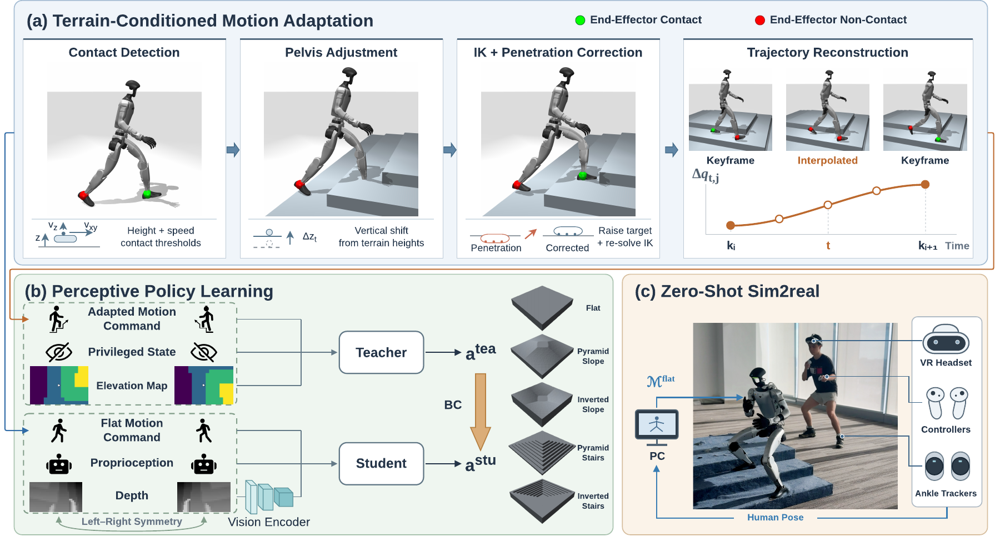

<h1 align="center">NEXUS: Perceptive Whole-Body Control<br>for Terrain-Adaptive Teleoperation</h1>

<p align="center">
  <a href="https://scholar.google.com/citations?user=wMMZpqYAAAAJ">Xiangyu Miao</a><sup>1,2</sup>,
  <a href="https://scholar.google.com/citations?user=RrZ_vZIAAAAJ">Junsong Wu</a><sup>1,2</sup>,
  <a href="https://scholar.google.com/citations?user=aVte5j4AAAAJ">Jiyuan Shi</a><sup>1</sup>,
  <a href="https://scholar.google.com/citations?user=Ey2NlGMAAAAJ">Weiji Xie</a><sup>1,2</sup>,
  <a href="https://scholar.google.com/citations?user=mJ7tn3MAAAAJ">Jinrui Han</a><sup>3</sup>,
  <a href="https://scholar.google.com/citations?user=w7dfT-gAAAAJ">Xingyi Wang</a><sup>1,4</sup>
  <br>
  <a href="https://scholar.google.com/citations?user=Qzss0GEAAAAJ">Weinan Zhang</a><sup>2,†</sup>,
  <a href="https://scholar.google.com/citations?user=Rm_1y2kAAAAJ">Chenjia Bai</a><sup>1,5,†</sup>,
  <a href="https://scholar.google.com/citations?user=ahUibskAAAAJ">Xuelong Li</a><sup>1</sup>
</p>

<p align="center">
  <sup>1</sup>The Institute of Artificial Intelligence, China Telecom (TeleAI)
  &nbsp; <sup>2</sup>Shanghai Jiao Tong University
  <br>
  <sup>3</sup>The University of Hong Kong
  &nbsp; <sup>4</sup>Zhejiang University
  &nbsp; <sup>5</sup>γ-Robotics
  <br>
  <sup>†</sup>Corresponding authors
</p>

<p align="center">
  <a href="https://nexus-humanoid.github.io/"></a>
  <a href="https://gamma-robot.github.io/NEXUS/"></a>
  <a href="https://arxiv.org/abs/2609.39000"></a>
  <a href="https://nexus-humanoid.github.io/#video"></a>
  <a href="https://nexus-humanoid.github.io/demo/"></a>
</p>

## Overview

<p align="center">
  <a href="https://nexus-humanoid.github.io/#method">
    
  </a>
</p>

This repository provides the official implementation of our paper, **[NEXUS: Perceptive Whole-Body Control for Terrain-Adaptive Teleoperation](https://arxiv.org/abs/2609.39000)**. NEXUS enables humanoid robots to follow whole-body teleoperation commands while using onboard perception to adapt their movements to the terrain.

1. **Adapt motions to terrain.** Generate time-aligned terrain variants from robot motions using contact detection, pelvis adjustment, keyframe IK and trajectory reconstruction.
2. **Train a privileged teacher.** PPO learns to track terrain-adapted references using privileged observations and terrain elevation.
3. **Distill a perceptive student.** The student combines the paired flat-ground motion command, proprioceptive history and depth images to imitate the teacher.

The code also includes one-stage perceptive PPO and optional left–right symmetry augmentation and regularization. Human-to-robot retargeting supplies the input robot motions as an upstream step.

## Release Status

- [x] Standalone terrain motion adaptation package
- [x] Policy training pipeline
- [x] Pretrained model (G1, ONNX)
- [x] Documentation
- [ ] Deployment: sim-to-sim and sim-to-real

## Repository Guide

| Component | Location | Purpose |
| --- | --- | --- |
| Standalone motion adaptation | [`terrain_motion_adaptation/`](terrain_motion_adaptation/) | Terrain adaptation, batch processing, bundled G1/terrain examples and motion replay |
| Data preparation | [`src/perceptive_bfm/scripts/data_process/`](src/perceptive_bfm/scripts/data_process/) | Training-terrain generation and grouped motion packing |
| Tasks and configurations | [`src/perceptive_bfm/tasks/perceptive/`](src/perceptive_bfm/tasks/perceptive/) | Perceptive motion-tracking environments and training configurations |
| RL algorithms | [`src/perceptive_bfm_rl/`](src/perceptive_bfm_rl/) | PPO and distillation implementations used by the training project |
| Training and playback | [`src/perceptive_bfm/scripts/`](src/perceptive_bfm/scripts/) | Train, play and scene-export entry points |
| Pretrained model | [`resources/g1/checkpoints/`](resources/g1/checkpoints/) | Perceptive behavior foundation model in ONNX format and inference configuration |
| Example motions | [`resources/g1/motions/pyramid/`](resources/g1/motions/pyramid/) | Walking, crawling with a back handspring, and backward roll, paired across flat ground and four terrains |

The root project installs `perceptive_bfm` and `perceptive_bfm_rl` together. `terrain_motion_adaptation` can also be installed separately for offline data generation.

See the [documentation](https://gamma-robot.github.io/NEXUS/) for installation, data preparation, training, playback and illustrated reference guides.

## Pretrained Perceptive Behavior Foundation Model

We provide a [pretrained perceptive behavior foundation model](resources/g1/checkpoints/policy.onnx)
for Unitree G1 in ONNX format. The model combines motion references,
proprioceptive history, and depth observations for terrain-adaptive whole-body
control. See the
[model documentation](resources/g1/checkpoints/README.md) for its interface and inference
configuration.

## Installation Guide

### 1. Install uv

Install [uv](https://docs.astral.sh/uv/getting-started/installation/) with the official installer:

```bash
curl -LsSf https://astral.sh/uv/install.sh | sh
```

Restart your terminal after installation so `uv` is available in your shell.

### 2. Install the project

Clone this repository, enter its root directory, and run:

```bash
uv sync --locked
```

This creates `.venv` and installs the project and its dependencies. The Python version is selected from `.python-version`. GPU training uses the CUDA 12.8 PyTorch wheels configured in this repository and requires a compatible NVIDIA driver.

Use `uv run` to run commands in this environment.

<details>
<summary><b>Motion adaptation only</b></summary>

For offline motion adaptation without the training dependencies, install from the standalone package directory instead:

```bash
cd terrain_motion_adaptation
uv sync --locked
```

Include the visualization extra for browser-based motion replay:

```bash
uv sync --locked --extra visualization
```

See the [standalone package guide](terrain_motion_adaptation/README.md) for usage.

</details>

## Workflow

| **1. Data preparation** | **2. Policy learning** | **3. Export & playback** |
| :--- | :--- | :--- |
| Retargeted flat-ground motions → terrain adaptation → grouped dataset packing | Privileged teacher PPO → perceptive student distillation | JIT/ONNX export and MuJoCo/Viser playback |
| **Output:** paired motion dataset | **Output:** trained perceptive policy | **Output:** exported models and simulation playback |

<details>
<summary><b>Motion data at a glance</b></summary>

Each terrain group has a `manifest.json` describing the joint order. Each clip is stored as `<relative-clip-path>/motion.npz`, written with `np.savez`:

| Field | Contents |
| --- | --- |
| `qpos` | float32 `(T, 7 + J)`: root XYZ, root quaternion **wxyz**, then scalar joint positions |
| `fps` | A finite positive scalar giving the clip's sampling rate |

Coordinates are right-handed with Z up; lengths use meters and angles use radians. The manifest's `joint_names` gives the joint-column order. Matching relative clip paths identify corresponding motions across terrain groups.

The exchange format allows per-clip FPS. A training pack requires one common FPS and frame-aligned terrain pairs. Packing validates the rate and does not resample. Body poses and velocities are reconstructed at runtime.

</details>

## Usage

Run the following commands from the repository root after installation. These examples use Unitree G1 and 50 FPS motions. Prepare your own retargeted robot motions; human-to-robot retargeting is an upstream step.

The [bundled G1 motion examples](resources/g1/motions/pyramid/) show terrain
optimization results, ready to replay without running the optimization pipeline.

### 1. Prepare flat-ground motions

Store input motions in the format described above:

```text
datasets/g1/flat/
├── manifest.json
└── walk/
    └── motion.npz
```

The manifest must contain `version: 1` and `joint_names` listing the scalar joints in the same order as the joint columns of `qpos`. Each NPZ must contain `qpos` and `fps`.

### 2. Adapt motions to terrain

Generate the four non-flat PyramidTerrain variants:

```bash
uv run python -m perceptive_bfm.scripts.data_process.adapt_motions \
  --input-dir datasets/g1/flat --base-dir datasets/g1/flat \
  --output-dir datasets/g1/pyramid --num-workers 32
```

CPU processing examples use 32 workers. Reduce this to fit the CPU quota and
memory available to your job or container, rather than the host CPU count.

The default light preflight checks shared paths and schemas at startup, then
validates individual clips in workers. Use `--preflight full` for the earlier
startup metadata and existing-output checks.

This writes `<terrain>_lv0/<clip>/motion.npz` under the output directory. Check the generation summary for skipped or failed clips. Keep the original flat motions as a paired group by creating this link once:

```bash
ln -s ../flat datasets/g1/pyramid/flat
```

Inspect the generated motions before packing:

```bash
uv run python -m perceptive_bfm.scripts.data_process.visualize_motions \
  --input-dir datasets/g1/pyramid
```

Open the URL printed by Viser. Select terrain groups and motions, then use pause, slow playback and frame scrubbing to inspect contact, foot sliding, penetration and motion continuity. This viewer replays reference poses without a policy checkpoint.

### 3. Pack the training dataset

```bash
uv run python -m perceptive_bfm.scripts.data_process.pack_motions \
  --input-dir datasets/g1/pyramid --output-dir dataset/g1/pyramid \
  --target-fps 50 --num-workers 32
```

Raw NPZ motions live under `datasets/`; packed training data live under `dataset/`. Packing checks the common FPS and frame counts of available terrain/flat pairs. `--target-fps` asserts the rate and does not resample motions. Training and play commands below take the packed group root, `dataset/g1/pyramid`.

### 4. Train the teacher

The training examples use four GPUs (`--gpu-ids 0 1 2 3`) with 16,384
environments per GPU (65,536 total). For a single GPU, use `--gpu-ids 0`.
Adjust `--env.scene.num-envs` to fit your available GPU memory.

```bash
uv run python -m perceptive_bfm.scripts.train \
  Perceptive-PyramidTerrain-Unitree-G1-Teacher-Symmetry \
  --env.scene.num-envs 16384 \
  --env.commands.motion.motion-file dataset/g1/pyramid \
  --agent.run-name teacher --agent.logger tensorboard --gpu-ids 0 1 2 3
```

Runs and checkpoints are saved under `logs/rsl_rl/g1_perceptive/<timestamp>_teacher/`. The teacher uses privileged observations and terrain elevation.

### 5. Distill the student

Use a trained teacher checkpoint from step 4. Replace `<teacher_run>` with its directory name under `logs/rsl_rl/g1_perceptive/`, and `<iteration>` with the checkpoint iteration:

```bash
uv run python -m perceptive_bfm.scripts.train \
  Perceptive-PyramidTerrain-Unitree-G1-BC-Symmetry \
  --env.scene.num-envs 16384 \
  --env.commands.motion.motion-file dataset/g1/pyramid \
  --agent.load-run "<teacher_run>" \
  --agent.load-checkpoint "model_<iteration>.pt" \
  --agent.run-name student --agent.logger tensorboard --gpu-ids 0 1 2 3
```

The student learns from the teacher using flat-ground motion commands, proprioceptive history and depth images. Student checkpoints are saved under `logs/rsl_rl/g1_perceptive/<timestamp>_student/`.

<details>
<summary><b>One-stage perceptive PPO</b></summary>

To train the perceptive policy directly with PPO:

```bash
uv run python -m perceptive_bfm.scripts.train \
  Perceptive-PyramidTerrain-Unitree-G1-Symmetry \
  --env.scene.num-envs 16384 \
  --env.commands.motion.motion-file dataset/g1/pyramid \
  --agent.run-name ppo --agent.logger tensorboard --gpu-ids 0 1 2 3
```

</details>

The examples enable left–right symmetry: mirror loss for PPO and augmented teacher supervision for distillation. See the [illustrated symmetry guide](docs/reference/symmetry.md). Remove `-Symmetry` from each task ID to use the corresponding configuration without it.

### 6. Play a trained policy

Replace `<student_run>` and `<iteration>` with the student run and checkpoint to replay:

```bash
uv run python -m perceptive_bfm.scripts.play \
  Perceptive-PyramidTerrain-Unitree-G1-BC-Symmetry \
  --motion-file dataset/g1/pyramid \
  --checkpoint-file "logs/rsl_rl/g1_perceptive/<student_run>/model_<iteration>.pt" \
  --num-envs 1 --viewer viser
```

Open the viewer URL to watch the simulated robot track its motion reference. To play a teacher or one-stage PPO checkpoint, use its matching task ID and checkpoint path. Use `--viewer native` for a desktop MuJoCo window. Pass a task ID before `--help` to inspect training or play options.

## Citation

If you find NEXUS useful in your research, please consider citing:

```bibtex
@misc{miao2026nexus,
  title = {{NEXUS}: Perceptive Whole-Body Control for Terrain-Adaptive Teleoperation},
  author = {Xiangyu Miao and Junsong Wu and Jiyuan Shi and Weiji Xie and Jinrui Han and Xingyi Wang and Weinan Zhang and Chenjia Bai and Xuelong Li},
  year = {2026},
  eprint = {2609.39000},
  archivePrefix = {arXiv},
  primaryClass = {cs.RO},
  doi = {10.48550/arXiv.2609.39000},
  url = {https://arxiv.org/abs/2609.39000}
}
```

## Acknowledgments

We thank the authors of [BeyondMimic](https://beyondmimic.github.io/), [SONIC](https://nvlabs.github.io/SONIC/), and [HEFT](https://heft.axell.top/) for their inspiring work. Our implementation builds on [mjlab](https://github.com/mujocolab/mjlab), [RSL-RL](https://github.com/leggedrobotics/rsl_rl), and [InstinctMJ](https://github.com/project-instinct/InstinctMJ), and we thank their authors and contributors for sharing these tools with the community.

## License

Original NEXUS contributions are licensed under [Creative Commons Attribution-NonCommercial 4.0 International (CC BY-NC 4.0)](LICENSE). Non-commercial sharing and adaptation are permitted subject to the license's attribution and other conditions. Uses outside the license require separate permission.

Third-party code and robot assets retain their own terms. In particular, the RSL-RL-derived PPO and distillation modules retain BSD-3-Clause. See [third-party notices](THIRD_PARTY_NOTICES.md).

## Contact

We welcome questions, feedback, and opportunities for collaboration. Feel free to reach out:

- **Xiangyu Miao**: [thedarkknight@sjtu.edu.cn](mailto:thedarkknight@sjtu.edu.cn) · [WeChat](https://nexus-humanoid.github.io/static/images/wechat-qr.jpg)
- **Junsong Wu**: [jason-w@sjtu.edu.cn](mailto:jason-w@sjtu.edu.cn) or via Weixin (`Wujunsong0818`)
- **Chenjia Bai** (Corresponding author): [baicj@chinatelecom.cn](mailto:baicj@chinatelecom.cn)
