# NEXUS

```{raw} html
<div class="nexus-home">
  <div class="home-intro">
    <p class="home-eyebrow">NEXUS</p>
    <h2 class="home-title">
      Perceptive
      <br>
      <span>whole-body control.</span>
    </h2>
    <p class="home-lead">Terrain-adaptive teleoperation for humanoid robots.</p>
    <div class="home-actions">
      <a class="home-button home-button-primary" href="guides/quickstart.html">
        Quickstart
        <span aria-hidden="true">→</span>
      </a>
      <a class="home-text-link" href="guides/pretrained-model.html">
        Pretrained model
        <span aria-hidden="true">→</span>
      </a>
    </div>
  </div>
  <figure class="home-adaptation">
    <div class="home-terrain-grid">
      <div class="home-terrain-column">
        <p class="home-terrain-label">Flat</p>
        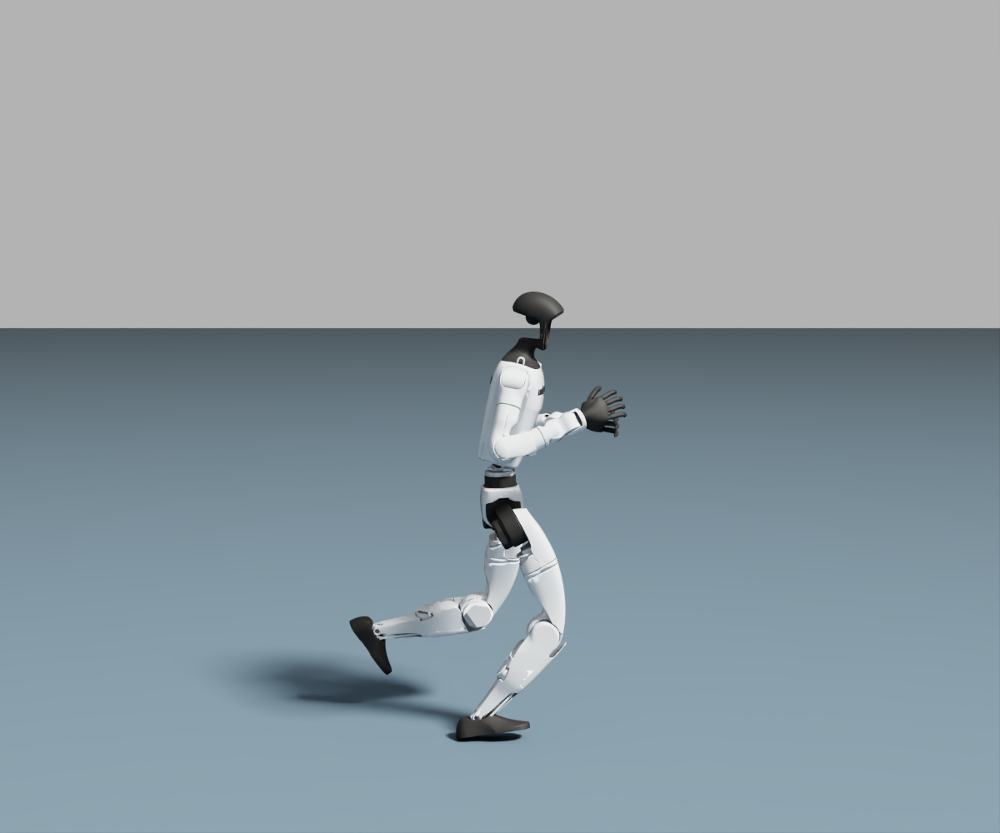
        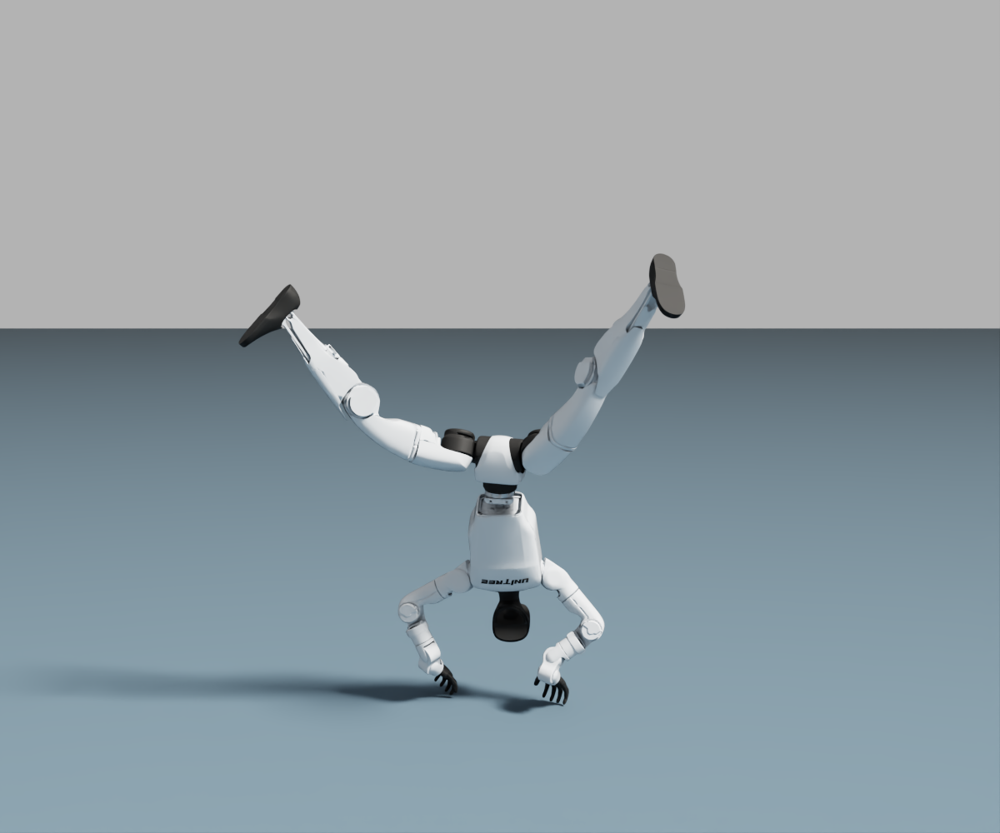
        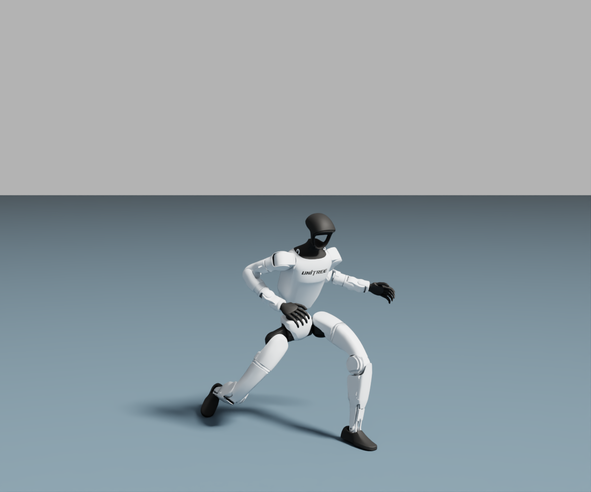
      </div>
      <div class="home-terrain-column">
        <p class="home-terrain-label">Stairs</p>
        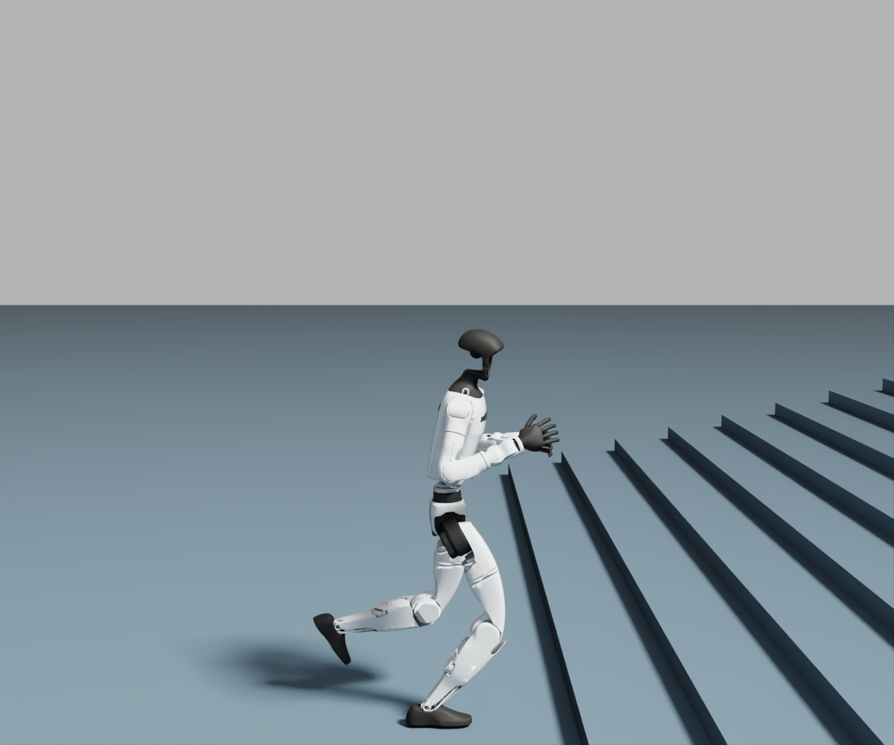
        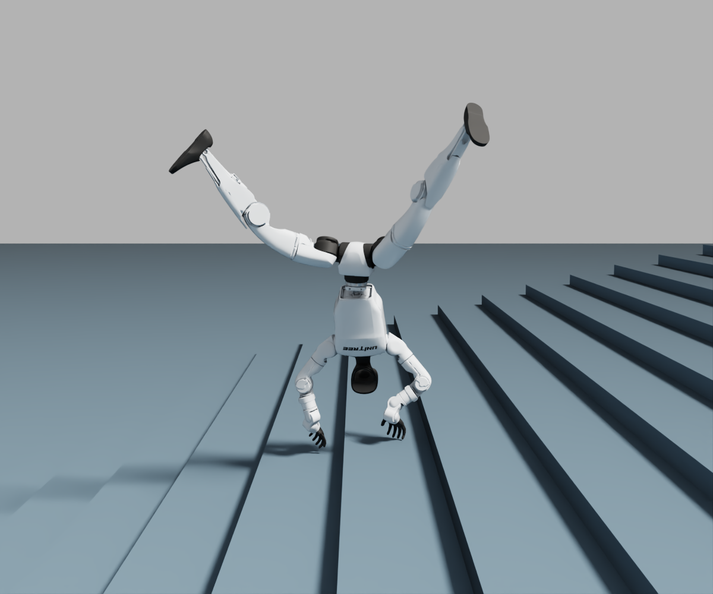
        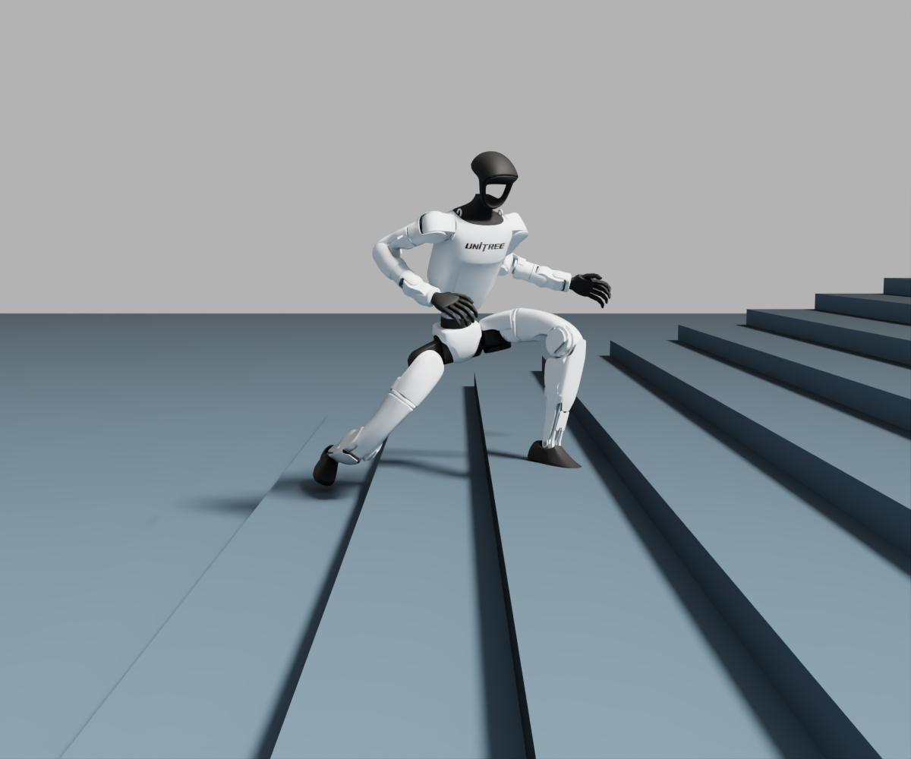
      </div>
      <div class="home-terrain-column">
        <p class="home-terrain-label">Slope</p>
        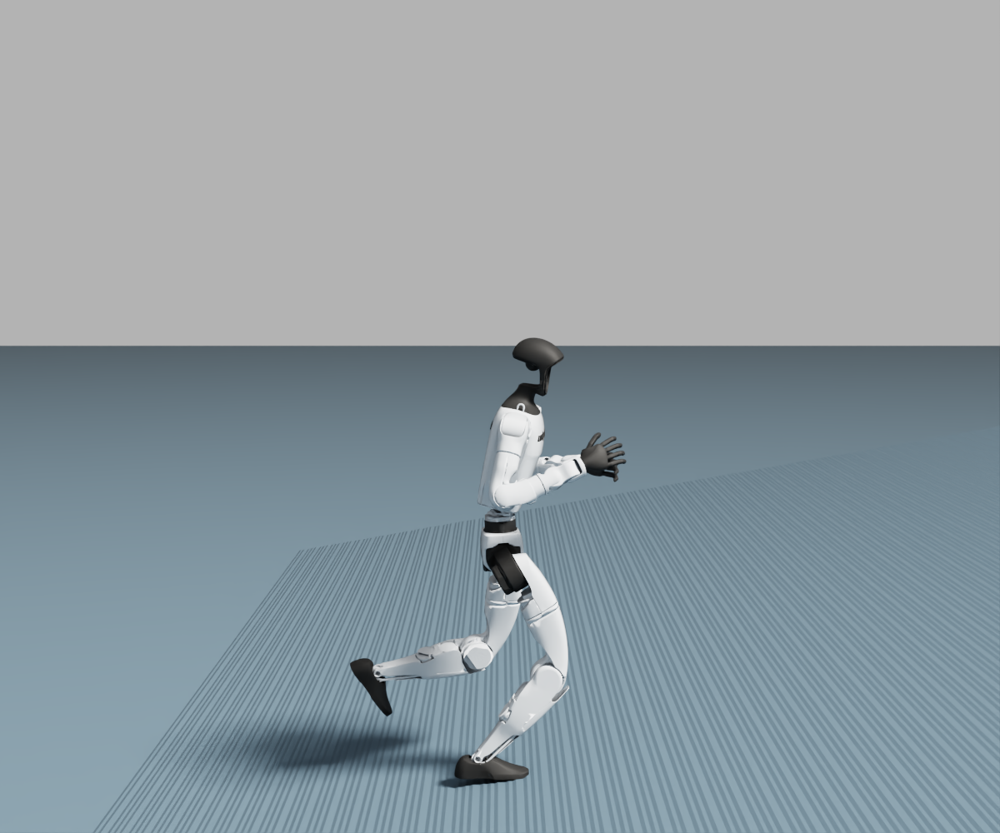
        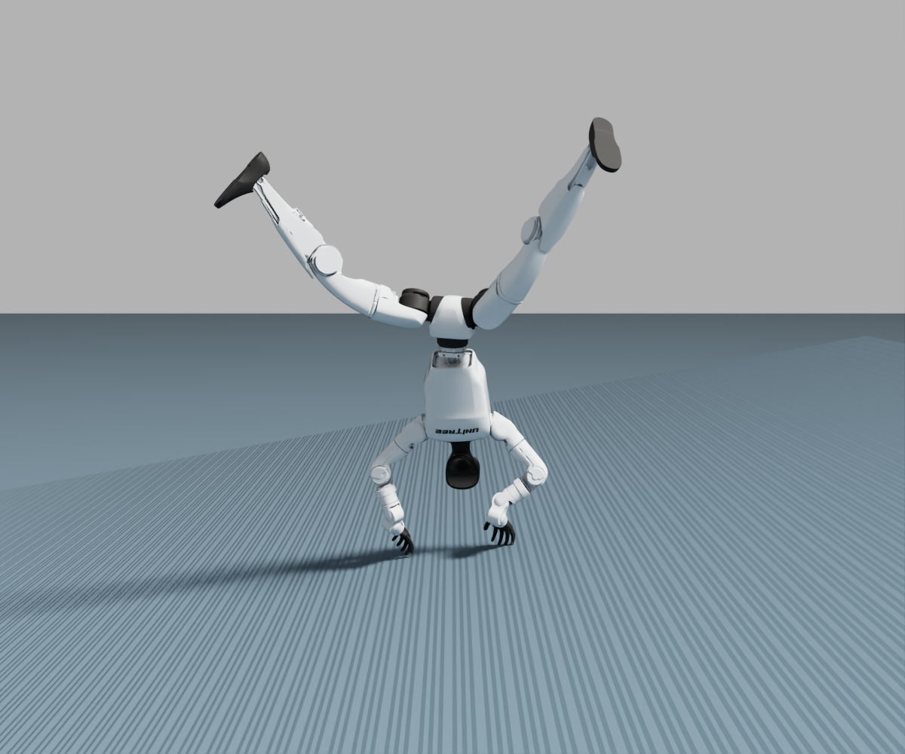
        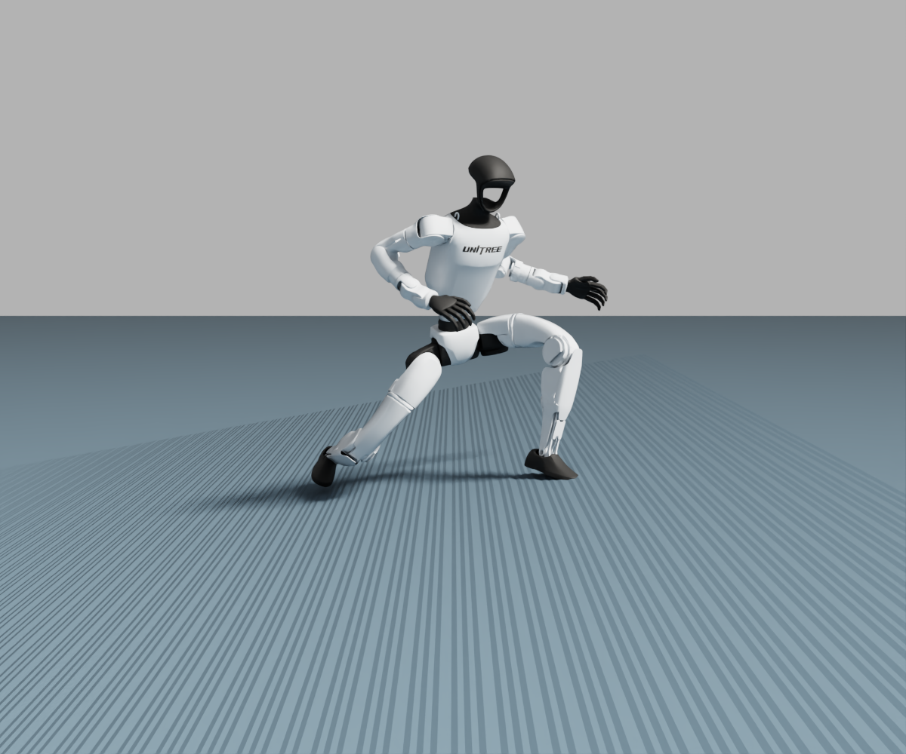
      </div>
      <div class="home-terrain-column">
        <p class="home-terrain-label">Wave</p>
        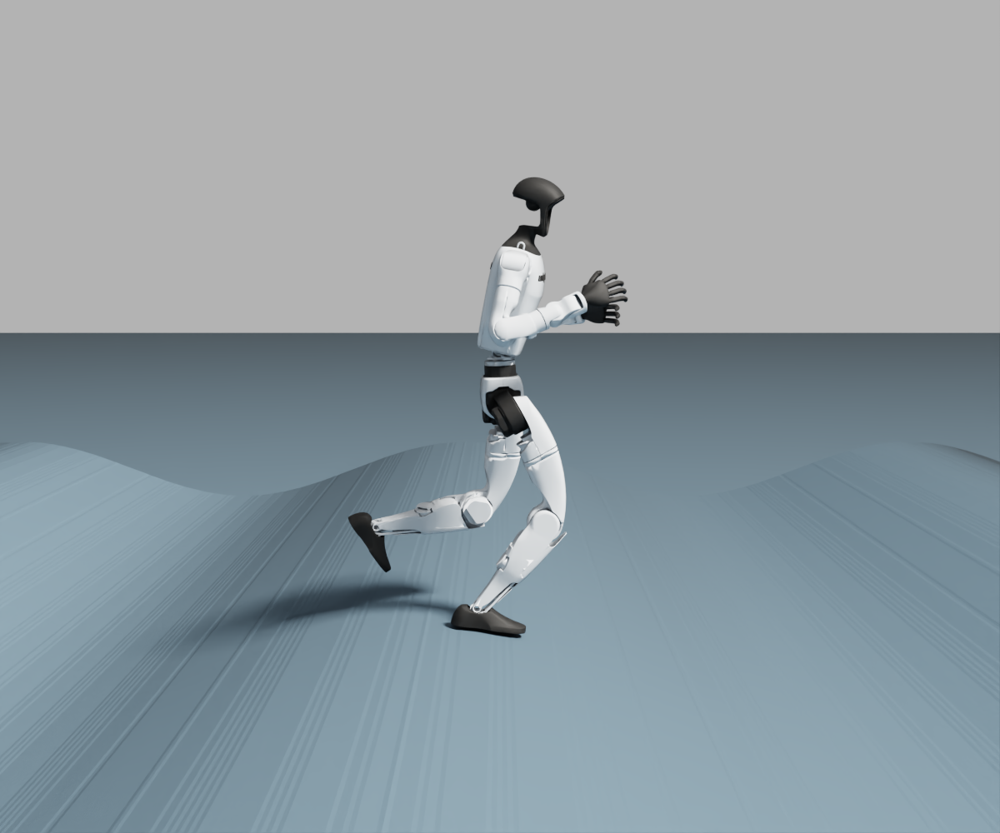
        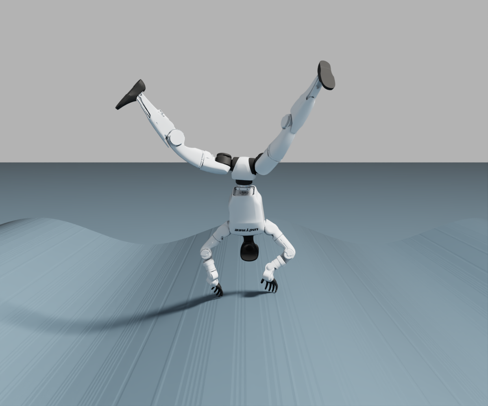
        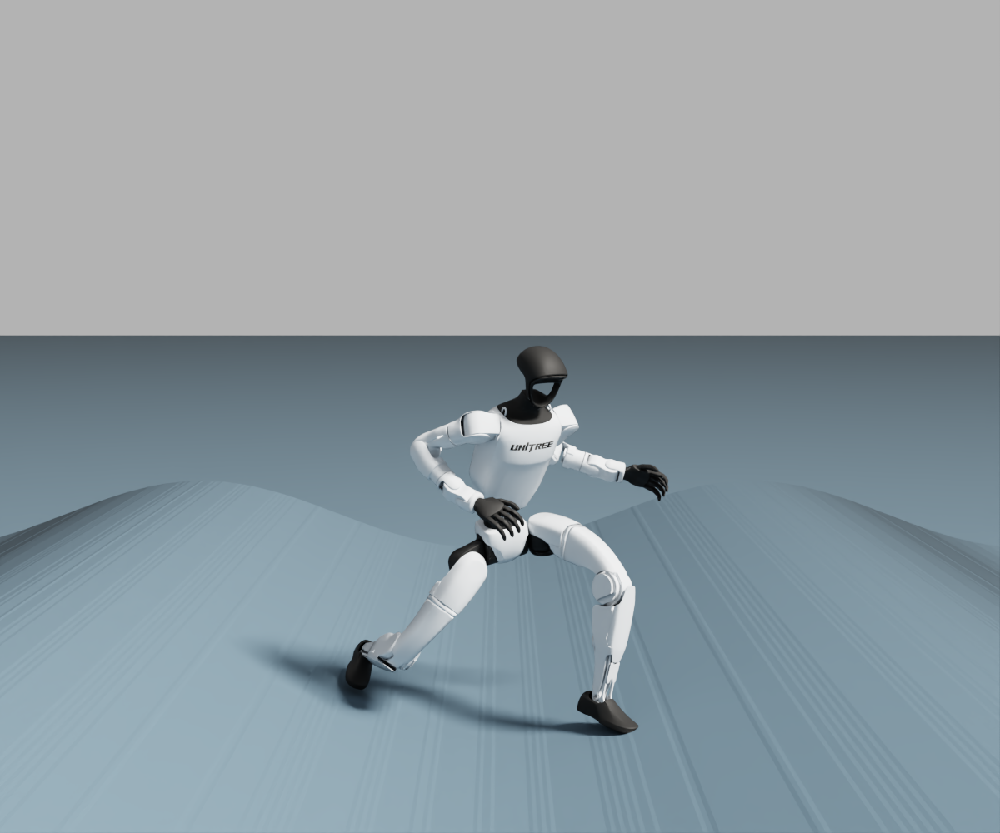
      </div>
    </div>
    <figcaption>Motion adaptation across terrains.</figcaption>
  </figure>
</div>
```

## Build with NEXUS

```{raw} html
<div class="home-workflow">
  <a href="guides/data-preparation.html">
    <span class="home-step">01 / ADAPT</span>
    <h3>Prepare your motions</h3>
    <p>Adapt robot motions to slopes and stairs, then pack your training dataset.</p>
    <span class="home-route">
      Data preparation
      <span aria-hidden="true">→</span>
    </span>
  </a>
  <a href="guides/training.html">
    <span class="home-step">02 / TRAIN</span>
    <h3>Learn perceptive control</h3>
    <p>Train a privileged teacher, then distill a perceptive student with depth observations.</p>
    <span class="home-route">
      Training
      <span aria-hidden="true">→</span>
    </span>
  </a>
  <a href="guides/playback.html">
    <span class="home-step">03 / EVALUATE</span>
    <h3>Run your policy</h3>
    <p>Run a trained policy in simulation and export its model or scene.</p>
    <span class="home-route">
      Playback &amp; export
      <span aria-hidden="true">→</span>
    </span>
  </a>
</div>
```

## Resources

```{raw} html
<div class="home-resources">
  <a class="home-resource" href="guides/pretrained-model.html">
    <span class="home-step">PRETRAINED MODEL</span>
    <h3>Perceptive behavior foundation model</h3>
    <p>G1 policy in ONNX format, with the joint, observation and control settings.</p>
    <span class="home-route">
      Model &amp; downloads
      <span aria-hidden="true">→</span>
    </span>
  </a>
  <a class="home-resource" href="guides/motion-examples.html">
    <span class="home-step">MOTION EXAMPLES</span>
    <h3>Terrain adaptation results</h3>
    <p>Replay optimized motions and inspect their contact with the terrain.</p>
    <span class="home-route">
      View examples
      <span aria-hidden="true">→</span>
    </span>
  </a>
  <a class="home-resource" href="guides/motion-adaptation.html">
    <span class="home-step">STANDALONE ADAPTATION</span>
    <h3>Standalone adaptation</h3>
    <p>Optimize robot motions on CPU with the standalone package.</p>
    <span class="home-route">
      Standalone guide
      <span aria-hidden="true">→</span>
    </span>
  </a>
</div>
```

## Method

```{figure} _static/media/method-overview.png
:alt: NEXUS pipeline: contact-guided terrain adaptation, privileged teacher training, perceptive student distillation and robot-side control.
:figclass: doc-figure method-overview

Method overview from the paper. These guides cover terrain adaptation and policy learning.
```

The supplied configuration uses the 29-joint Unitree G1. See the
[motion format](reference/motion-format.md) for robot reference inputs and
[terrain configuration](reference/terrains.md) for the shared scene.

```{toctree}
:hidden:
:maxdepth: 1
:caption: Getting started

Quickstart <guides/quickstart>
Installation <guides/installation>
```

```{toctree}
:hidden:
:maxdepth: 1
:caption: Workflow

Data preparation <guides/data-preparation>
Standalone adaptation <guides/motion-adaptation>
Training <guides/training>
Playback & export <guides/playback>
```

```{toctree}
:hidden:
:maxdepth: 1
:caption: Resources

Motion examples <guides/motion-examples>
Pretrained model <guides/pretrained-model>
```

```{toctree}
:hidden:
:maxdepth: 1
:caption: Reference

Motion format <reference/motion-format>
Terrains <reference/terrains>
Configuration <reference/configuration>
Symmetry <reference/symmetry>
```
